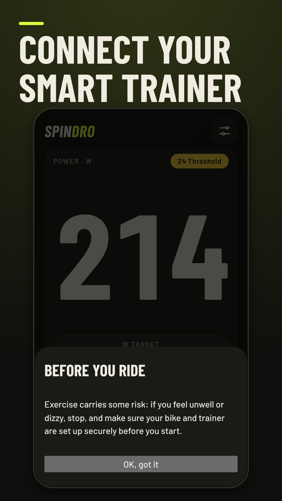
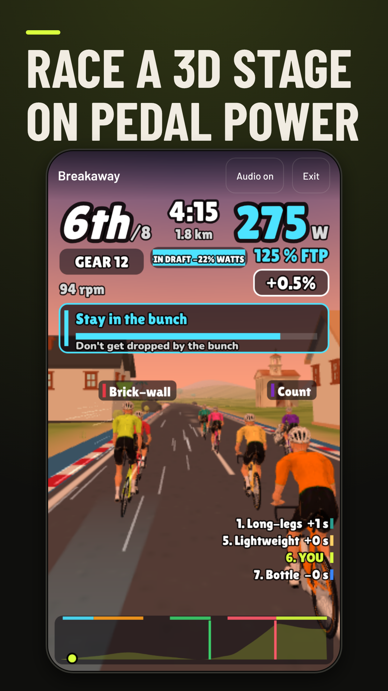
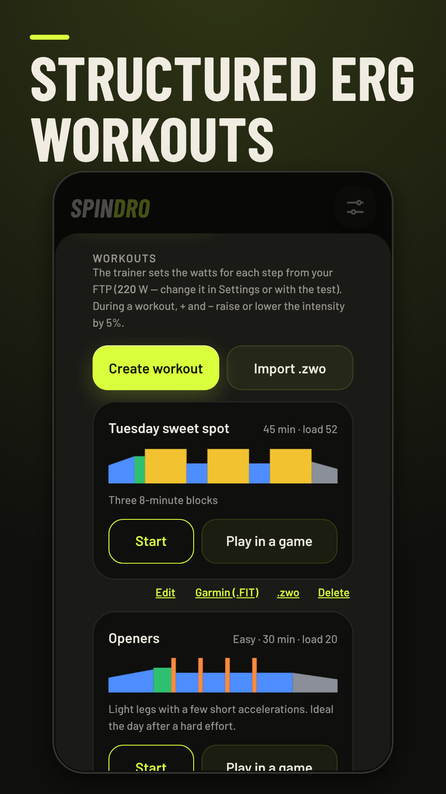
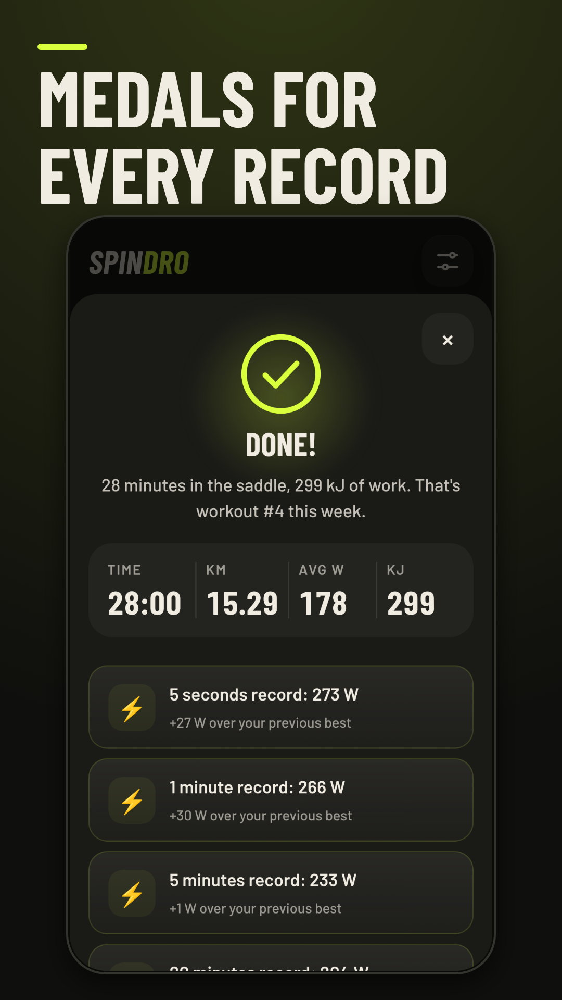

# Spindro: Smart Trainer Cycling

**Free, open-source indoor cycling app for smart trainers. No subscription, no account needed.**

Spindro runs in your browser (Android, PC, Mac) or as an Android app. It connects to your trainer over Bluetooth, gives you virtual gears, structured workouts and games driven by your real power, and can turn your phone into a sensor so the ride lands on your watch.

<p>




</p>

- **Website:** https://spindro.fun
- **Web app:** https://spindro.fun/app/ (Chrome or Edge)
- **Android APK:** https://spindro.fun/app/spindro.apk
- **Beta (testers):** https://spindro.fun/beta/ and https://spindro.fun/beta/spindro-beta.apk, see [docs/environments.md](docs/environments.md)

## What it does

- **Virtual gears** (24 ratios) on any controllable trainer, like a Zwift Cog setup, plus ERG, slope and resistance modes. Optional auto-shift keeps your cadence.
- **Zwift Click, Play and Ride** as shifters and as a full remote: you can drive the whole app from the handlebar.
- **Workouts:** 34 structured workouts, 4 multi-week plans, a ramp FTP test, a block editor, `.zwo` import, export to `.zwo` and Garmin workout `.fit`.
- **Games in 3D** driven by your watts: a stage race with drafting and climbs that load the trainer, a horde shooter, a peloton builder.
- **Routes:** load a GPX and the slope follows the course. **Video rides:** a YouTube video or your own file plays at your speed.
- **Your watch as the head unit** (Android app): the phone broadcasts power, cadence and speed as a Bluetooth sensor.
- **Records and history**, monthly challenges, a share card, `.fit` export with GPS for Garmin Connect, optional Strava upload.
- **5 languages:** English, Italian, French, Spanish, German. Voice coach included.
- **Private by default:** everything stays on your device. The optional account and anonymous statistics are off unless a deployment configures them.

## Compatibility

| | Status |
|---|---|
| Van Rysel D100 (FTMS) | Tested on the real trainer |
| Other FTMS trainers (most trainers since 2020) | Should work; please report |
| Tacx FE-C over BLE, Wahoo legacy (old Kickr/Snap/Core firmware) | Implemented, tested only against simulated devices |
| Zwift Click | Only the + / − keys of one Click v2 were tested on the real device; other keys and firmware not verified |
| Zwift Play, Zwift Ride | Implemented, tested only against simulated devices |
| Garmin watches (sensor bridge) | Implemented as a standard Bluetooth sensor, not yet verified on a real watch; please report your model |
| Wahoo Elemnt, Coros, Suunto, Polar, Apple Watch | Should work; please report |

Use **Settings → Report your trainer** in the app, or open a [trainer compatibility issue](../../issues/new/choose). Reports are how this table grows.

**Requirements:** Android with Chrome or the app; PC, Mac, Linux or ChromeOS with Chrome or Edge and Bluetooth. iPhone and iPad: Safari has no Web Bluetooth, so use the free Bluefy browser. A trainer accepts one Bluetooth connection at a time: close other apps first.

## Run it locally

```sh
npm ci
node tests/serve.mjs          # http://127.0.0.1:4173
npm test                      # Playwright tests with a simulated trainer
node tests/trainers/run.mjs   # trainer protocol tests
```

No build step: plain ES modules in `js/`, three.js vendored in `vendor/`. The Android app is the same web app in a Capacitor shell (`android/`, see [docs/android.md](docs/android.md)).

## Contributing

Trainer support, translations and games are the best places to start: see [CONTRIBUTING.md](CONTRIBUTING.md). Security reports: [SECURITY.md](SECURITY.md).

<!-- games:begin -->
## Games

Spindro has six games, all workouts in % of your FTP, played with + / − and the pedals. Adding a seventh is meant to be easy:
one folder, one registry entry, its strings. Start with [Create a game](docs/games/CREATE-A-GAME.md) (15 minutes, no trainer needed:
`npm run dev`, then `?game=tempo&demo=1`), the [game API](docs/games/API.md) and the [design rules](docs/games/DESIGN-RULES.md).
<!-- games:end -->

## Known limits

- The app replaces Zwift as the trainer controller: both cannot be connected at once.
- Garmin Connect has no public upload API: export the `.fit` and import it on the Garmin Connect website, or record on the watch through the sensor bridge.
- On trainers that do not send cadence (the D100 for one), cadence is estimated from flywheel speed: calibrate it in Settings, or pair a cadence sensor.

## License

[GPL-3.0](LICENSE). Zwift, Garmin, Strava, Tacx, Wahoo, Van Rysel and the other names are trademarks of their owners; Spindro is not affiliated with them.

## Credits

Everything third-party that ships with Spindro, with author, licence and use. Full licence texts: [THIRD-PARTY-NOTICES.md](THIRD-PARTY-NOTICES.md); the readable list is in [docs/legal/licenses.en.md](docs/legal/licenses.en.md) and in the app (Settings → Open-source licences).

**Code**
- [three.js](https://threejs.org) r170, three.js authors, MIT: 3D engine of the games, in `vendor/three` (with its add-ons: `GLTFLoader`, post-processing, `BufferGeometryUtils`).
- [meshoptimizer](https://github.com/zeux/meshoptimizer) decoder 0.18, Arseny Kapoulkine, MIT: decompresses the 3D models, in `vendor/three/addons/libs`.
- [Capacitor](https://capacitorjs.com) 7.6.10, Drifty Co., MIT, plus `@capacitor/local-notifications` (Ionic, MIT) and `@capacitor-community/bluetooth-le` (MIT): the Android shell, in `vendor/capacitor` and `android/`.
- AndroidX `appcompat`, `coordinatorlayout`, `core-splashscreen`, The Android Open Source Project, Apache 2.0 (Android app).
- Trainer and controller protocols were learned from public documents and open-source projects (Tacx "FE-C over BLE", ANT+ FE-C, GoldenCheetah, SwiftySensors, incyclist, ajchellew/zwiftplay, SwiftControl, qdomyos-zwift). No code is copied and **no Zwift code, key or asset is included**; see `js/click.js`, `js/trainers/` and [docs/zwift-controller.md](docs/zwift-controller.md).

**Fonts** (SIL Open Font License 1.1, all served by the app itself, in `assets/fonts`)
- [Barlow and Barlow Condensed](https://github.com/jpt/barlow), The Barlow Project Authors: text and numbers.
- Lilita One, Juan Montoreano: game titles. [Nunito](https://github.com/googlefonts/nunito), The Nunito Project Authors: game texts.

**3D models, particles and sound** (CC0 1.0, no credit required, given anyway)
- [Kenney](https://kenney.nl): Racing Kit, Nature Kit, Blocky Characters, Graveyard Kit, Blaster Kit, Platformer Kit (3D, `assets/3d`), Particle Pack (`assets/fx`), Music Jingles (`assets/audio/jingles`).
- [Quaternius](https://quaternius.com): Ultimate Modular Men, Simple Nature Pack, Farm Buildings, Simple Buildings (`assets/3d/quaternius`, converted and optimised).

**Generated with [Meshy](https://www.meshy.ai) for Spindro**: the models in `assets/3d/meshy/` (cyclist, fan, zombies, ogre, bikes, finish arch, podium, team car, buildings, scenery, farm animals, the Pedal Strike robots, mech, drone and so on) and the home icons in `assets/icons/`. The models generated on Meshy's free plan are licensed [CC BY 4.0](https://creativecommons.org/licenses/by/4.0/) and credited here to **Meshy** (https://www.meshy.ai); those made on a paid plan need no attribution. The repository does not record which model came from which plan, so all are credited.

**Everything else** (code, icons, the games' design and their generated sounds) is original and GPL-3.0.
