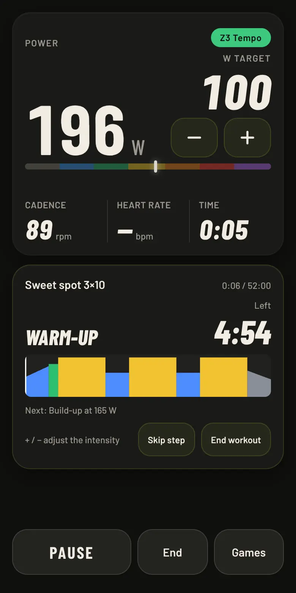
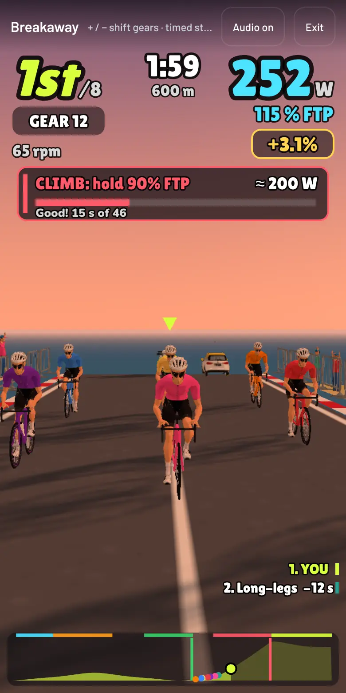
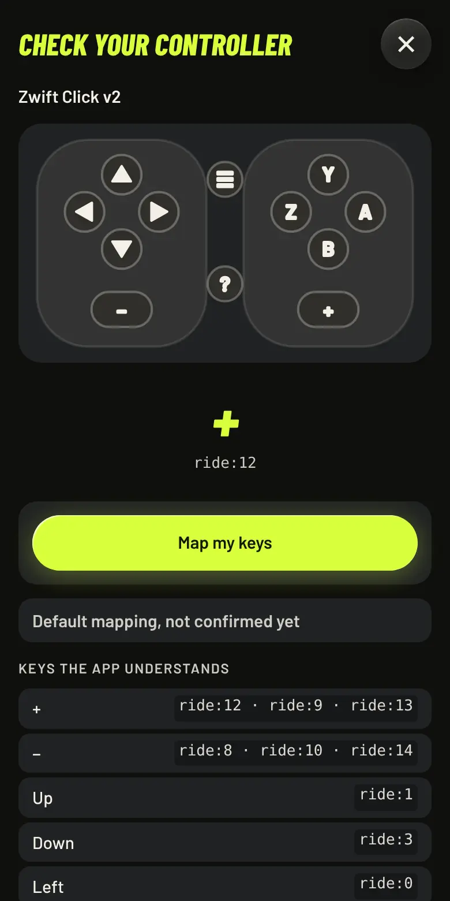

# Spindro: Smart Trainer Cycling

**Free, open-source indoor cycling app for smart trainers. No subscription, no account.**

Spindro connects to your trainer over Bluetooth and gives you ERG, virtual gears, structured workouts and six games that are workouts, in the browser or as an Android app. Everything stays on your device.

<p>





</p>

## Try it

- **Website:** https://spindro.fit, with a [blog](https://spindro.fit/blog/) on how it works
- **Web app:** https://spindro.fit/app/ (Chrome or Edge)
- **Android APK:** https://spindro.fit/app/spindro.apk
- **Beta (testers):** https://spindro.fit/beta/ and its APK, see [docs/environments.md](docs/environments.md)

## Features

- **ERG first.** The home is a "Today" card: a target in watts, − / +, Start. Slope and resistance modes are one tap away.
- **Virtual gears:** 24 ratios on a controllable trainer, with optional auto-shift. Where a trainer sends no cadence, the app estimates it from flywheel speed; calibrate it in Settings.
- **One "Add device"** for a trainer, a Zwift controller, a heart rate strap, a power meter or a cadence sensor.
- **Zwift Click, Play and Ride** as shifter and remote, with a key check that shows which key the app receives and lets you map it.
- **Workouts:** 34 structured workouts (24 to 90 minutes), 4 multi-week plans, a ramp FTP test, a block editor, `.zwo` import, export to `.zwo` and Garmin `.fit`, a spoken coach in 5 languages.
- **Six games that are workouts:** Breakaway, Horde Run, Pedal Strike, Slipstream, Updraft, Feed Zone. 5, 10 or 20 minutes in % of FTP, three levels, one shared menu. A game can also follow the workout you are riding. Plus any YouTube ride video at your speed.
- **Routes:** load a GPX and the slope follows the course.
- **Your watch as the head unit** (Android app): the phone broadcasts power, cadence and speed as a Bluetooth sensor.
- **History and records,** a share card, `.fit` export with GPS, optional Strava upload.
- **5 languages:** English, Italian, French, Spanish, German.
- **Private by default.** Rides stay on your device. Anonymous usage counting asks for your consent in the app.

## Supported devices, honestly

Only what has been ridden on real hardware is called verified. Details and notes: [spindro.fit/compatibility](https://spindro.fit/compatibility/).

| | Status |
|---|---|
| Van Rysel D100 (FTMS) | Tested on the real trainer |
| Zwift Click | Only the + / − keys of one Click v2 were tested on the real device; other keys and firmware not verified |
| Other FTMS trainers | Should work, never tried; please report |
| Tacx FE-C over BLE, Wahoo legacy | Implemented, tested only against simulated devices |
| Zwift Play, Zwift Ride | Implemented, tested only against simulated devices |
| Garmin watches (sensor bridge) | Implemented as a standard Bluetooth sensor, not yet verified on a real watch; please report your model |
| Wahoo Elemnt, Coros, Suunto, Polar, Apple Watch | Should work; please report |

**Requirements:** Android with Chrome or the app; PC, Mac, Linux or ChromeOS with Chrome or Edge and Bluetooth. iPhone and iPad: Safari has no Web Bluetooth; a browser that adds it should work, untested. A trainer accepts one Bluetooth connection at a time: close other apps first. What works where, reconnecting and troubleshooting: [docs/connecting-devices.md](docs/connecting-devices.md).

## Run it locally

```sh
npm ci
node tests/serve.mjs          # http://127.0.0.1:4173
npm test                      # Playwright tests with a simulated trainer
node tests/trainers/run.mjs   # trainer protocol tests
node site/build.mjs           # build the showcase site into site/dist
node scripts/site-shots.mjs   # regenerate the screenshots used by the site and this file
```

No build step for the app: plain ES modules in `js/`, three.js vendored in `vendor/`. The Android app is the same web app in a Capacitor shell (`android/`, see [docs/android-and-install.md](docs/android-and-install.md)).

## Add a game

A game is one folder, one registry entry and its strings. [docs/games/CREATE-A-GAME.md](docs/games/CREATE-A-GAME.md) goes from a fresh clone to a game on your screen in about 15 minutes; the interface is in [docs/games/API.md](docs/games/API.md) and the rules in [docs/games/DESIGN-RULES.md](docs/games/DESIGN-RULES.md). `npm run game:check -- <id>` checks a game against them. Overview: [Build a game](https://spindro.fit/developers/).

## Report a trainer

Use **Settings → Report your trainer** in the app, or open a [trainer compatibility issue](../../issues/new/choose) with the model, what worked and what did not. Reports are how the table above grows. Other contributions: [CONTRIBUTING.md](CONTRIBUTING.md). Security: [SECURITY.md](SECURITY.md).

<!-- games:begin -->
## Games

Spindro has six games, all workouts in % of your FTP, played with + / − and the pedals. Adding a seventh is meant to be easy:
one folder, one registry entry, its strings. Start with [Create a game](docs/games/CREATE-A-GAME.md) (15 minutes, no trainer needed:
`npm run dev`, then `?game=tempo&demo=1`), the [game API](docs/games/API.md) and the [design rules](docs/games/DESIGN-RULES.md).
<!-- games:end -->

## Known limits

- No online world or multiplayer.
- Garmin Connect has no public upload API: export the `.fit` and import it on the Garmin Connect website, or record on the watch through the sensor bridge.
- On trainers that send no cadence (the D100 for one) cadence is estimated; calibrate it or pair a cadence sensor.

## Licence and trademarks

[AGPL-3.0](LICENSE). The name "Spindro" and its logo are not covered by the licence: a modified version must use its own name and logo. Zwift, Garmin, Strava, Tacx, Wahoo, Van Rysel, Decathlon, YouTube and the other names are trademarks of their owners; Spindro is not affiliated with them.

## Credits

Everything third-party that ships with Spindro, with author, licence and use. Full licence texts: [THIRD-PARTY-NOTICES.md](THIRD-PARTY-NOTICES.md); the readable list is in [docs/legal/licenses.en.md](docs/legal/licenses.en.md) and in the app (Settings → Open-source licences).

**Code**
- [three.js](https://threejs.org) r170, three.js authors, MIT: 3D engine of the games, in `vendor/three` (with its add-ons: `GLTFLoader`, post-processing, `BufferGeometryUtils`).
- [meshoptimizer](https://github.com/zeux/meshoptimizer) decoder 0.18, Arseny Kapoulkine, MIT: decompresses the 3D models, in `vendor/three/addons/libs`.
- [Capacitor](https://capacitorjs.com) 7.6.10, Drifty Co., MIT, plus `@capacitor/local-notifications` (Ionic, MIT) and `@capacitor-community/bluetooth-le` (MIT): the Android shell, in `vendor/capacitor` and `android/`.
- AndroidX `appcompat`, `coordinatorlayout`, `core-splashscreen`, The Android Open Source Project, Apache 2.0 (Android app).
- Trainer and controller protocols were learned from public documents and open-source projects (Tacx "FE-C over BLE", ANT+ FE-C, GoldenCheetah, SwiftySensors, incyclist, ajchellew/zwiftplay, SwiftControl, qdomyos-zwift). No code is copied and **no Zwift code, key or asset is included**; see `js/click.js`, `js/trainers/` and [docs/zwift-controller.md](docs/zwift-controller.md).

**Fonts** (SIL Open Font License 1.1, all served by the app itself, in `assets/fonts`)
- [Barlow and Barlow Condensed](https://github.com/jpt/barlow), The Barlow Project Authors: text and numbers.
- Lilita One, Juan Montoreano: game titles. [Nunito](https://github.com/googlefonts/nunito), The Nunito Project Authors: game texts.

**3D models, particles and sound** (CC0 1.0, no credit required, given anyway)
- [Kenney](https://kenney.nl): Racing Kit, Nature Kit, Blocky Characters, Graveyard Kit, Blaster Kit, Platformer Kit (3D, `assets/3d`), Particle Pack (`assets/fx`), Music Jingles (`assets/audio/jingles`).
- [Quaternius](https://quaternius.com): Ultimate Modular Men, Simple Nature Pack, Farm Buildings, Simple Buildings (`assets/3d/quaternius`, converted and optimised).

**Generated with [Meshy](https://www.meshy.ai) for Spindro**: the models in `assets/3d/meshy/` (cyclist, fan, zombies, ogre, bikes, finish arch, podium, team car, buildings, scenery, farm animals, the Pedal Strike robots, mech, drone and so on) and the home icons in `assets/icons/`. The models generated on Meshy's free plan are licensed [CC BY 4.0](https://creativecommons.org/licenses/by/4.0/) and credited here to **Meshy** (https://www.meshy.ai); those made on a paid plan need no attribution. The repository does not record which model came from which plan, so all are credited.

**Everything else** (code, icons, the games' design and their generated sounds) is original and AGPL-3.0.
