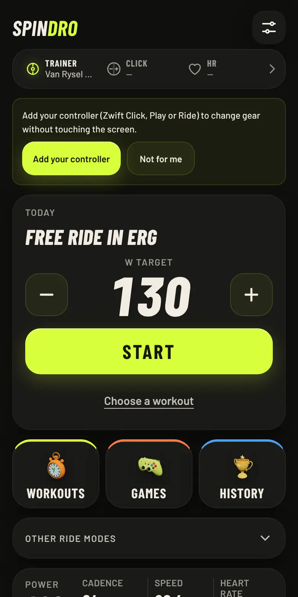
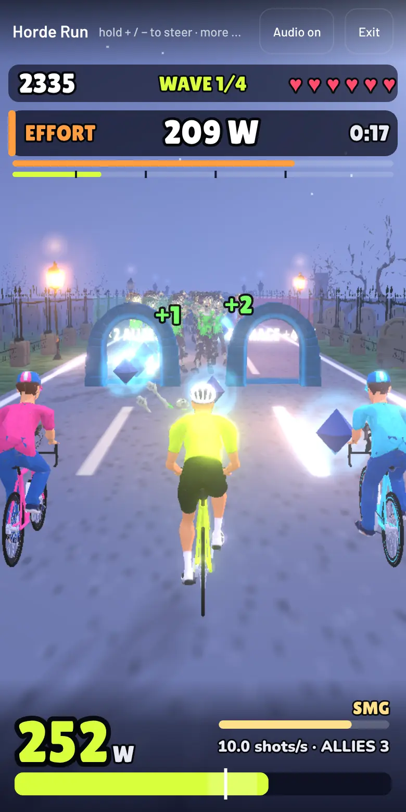

# Spindro: Smart Trainer Cycling

**Free, open-source indoor cycling app for smart trainers. No subscription, no account.**

Spindro connects to your trainer over Bluetooth and gives you ERG, virtual gears, structured workouts and six games that are workouts, in the browser or as an Android app. Everything stays on your device.

<p>





</p>

## Try it

- **Website:** https://spindro.fun, with a [blog](https://spindro.fun/blog/) on how it works
- **Web app:** https://spindro.fun/app/ (Chrome or Edge)
- **Android APK:** https://spindro.fun/app/spindro.apk
- **Beta (testers):** https://spindro.fun/beta/ and its APK, see [docs/environments.md](docs/environments.md)

## Features

- **ERG first.** The home is a "Today" card: a target in watts, − / +, Start. Slope and resistance modes are one tap away.
- **Virtual gears:** 24 ratios on a controllable trainer, with optional auto-shift. Where a trainer sends no cadence, the app estimates it from flywheel speed; calibrate it in Settings.
- **One "Add device"** for a trainer, a Zwift controller, a heart rate strap, a power meter or a cadence sensor.
- **Zwift Click, Play and Ride** as shifter and remote, with a key check that shows which key the app receives and lets you map it.
- **Workouts:** 34 structured workouts (24 to 90 minutes), 4 multi-week plans, a ramp FTP test, a block editor, `.zwo` import, export to `.zwo` and Garmin `.fit`, a spoken coach in 5 languages.
- **Six games that are workouts:** Breakaway, Horde Run, Pedal Strike, Slipstream, Updraft, Feed Zone. 5, 10 or 20 minutes in % of FTP, three levels, one shared menu. Plus any YouTube ride video at your speed.
- **Routes:** load a GPX and the slope follows the course.
- **Your watch as the head unit** (Android app): the phone broadcasts power, cadence and speed as a Bluetooth sensor.
- **History and records,** a share card, `.fit` export with GPS, optional Strava upload.
- **5 languages:** English, Italian, French, Spanish, German.
- **Private by default.** Rides stay on your device. Anonymous usage counting asks for your consent in the app.

## Supported devices, honestly

Only what has been ridden on real hardware is called verified. Details and notes: [spindro.fun/compatibility](https://spindro.fun/compatibility/).

| | Status |
|---|---|
| Van Rysel D100 (FTMS) | Tested on the real trainer |
| Zwift Click v2: + and − keys | Tested on the real device; arrows and A/B/Y/Z are not confirmed |
| Other FTMS trainers | Should work, never tried |
| Tacx FE-C over BLE, Wahoo legacy | Implemented, tested only against simulated devices |
| Zwift Play, Zwift Ride | Implemented, tested only against simulated devices |
| Garmin and other watches (sensor bridge) | Should work, not tested by us |

**Requirements:** Android with Chrome or the app; PC, Mac, Linux or ChromeOS with Chrome or Edge and Bluetooth. iPhone and iPad: Safari has no Web Bluetooth; a browser that adds it should work, untested. A trainer accepts one Bluetooth connection at a time: close other apps first.

## Run it locally

```sh
npm ci
node tests/serve.mjs          # http://127.0.0.1:4173
npm test                      # Playwright tests with a simulated trainer
node tests/trainers/run.mjs   # trainer protocol tests
node site/build.mjs           # build the showcase site into site/dist
node scripts/site-shots.mjs   # regenerate the screenshots used by the site and this file
```

No build step for the app: plain ES modules in `js/`, three.js vendored in `vendor/`. The Android app is the same web app in a Capacitor shell (`android/`, see [docs/android.md](docs/android.md)).

## Add a game

Games are small modules on a shared kit in [`js/games/`](js/games/), following the rules in [docs/giochi-design.md](docs/giochi-design.md). The [Build a game page](https://spindro.fun/developers/) explains the kit and the steps.

## Report a trainer

Use **Settings → Report your trainer** in the app, or open a [trainer compatibility issue](../../issues/new/choose) with the model, what worked and what did not. Reports are how the table above grows. Other contributions: [CONTRIBUTING.md](CONTRIBUTING.md). Security: [SECURITY.md](SECURITY.md).

## Known limits

- No online world or multiplayer.
- Garmin Connect has no public upload API: export the `.fit` and import it on the Garmin Connect website, or record on the watch through the sensor bridge.
- On trainers that send no cadence (the D100 for one) cadence is estimated; calibrate it or pair a cadence sensor.

## Licence and trademarks

[GPL-3.0](LICENSE). Zwift, Garmin, Strava, Tacx, Wahoo, Van Rysel, Decathlon, YouTube and the other names are trademarks of their owners; Spindro is not affiliated with them.

## Credits
- Modelli 3D: [Kenney](https://kenney.nl) — Racing Kit, Nature Kit, Blocky Characters, Graveyard Kit,
  Blaster Kit, Platformer Kit (gioielli e monete) (CC0), in `assets/3d`.
- Personaggi 3D in `assets/3d/meshy/` (ciclista, tifoso, zombie, orco, più bici, arco del traguardo, podio, auto del team, tenda ristoro, baita, chiesa, cascina, cipresso, balla di fieno, trattore, staccionata, pecora, mucca, mulino, zombie corridore, zombie bestione, scheletro, lapidi, cancellata, cripta, albero secco, lampione, portale e blaster per L'Orda; robot soldato, robot bestione, mech, drone, carro ruspa, dirigibile, gabbia, gru del porto e grattacielo al neon per Pedal Strike): generati con [Meshy](https://www.meshy.ai) per Spindro (CC BY 4.0 per i modelli del piano gratuito; i modelli nuovi sono fatti con l'abbonamento e non richiedono attribuzione).
- Modelli 3D: [Quaternius](https://quaternius.com) — Ultimate Modular Men (ciclista e pubblico), Simple Nature Pack,
  Farm Buildings, Simple Buildings (CC0), in `assets/3d/quaternius` (convertiti e ottimizzati).
- Decoder meshopt: [meshoptimizer](https://github.com/zeux/meshoptimizer) (MIT), in `vendor/three/addons/libs`.
- Particelle: Kenney — Particle Pack (CC0), in `assets/fx` (scie dei colpi, lampi, fumo, scintille).
- Jingle: Kenney — Music Jingles (CC0), in `assets/audio/jingles`.
- Motore 3D: [three.js](https://threejs.org) (MIT), in `vendor/three`.
