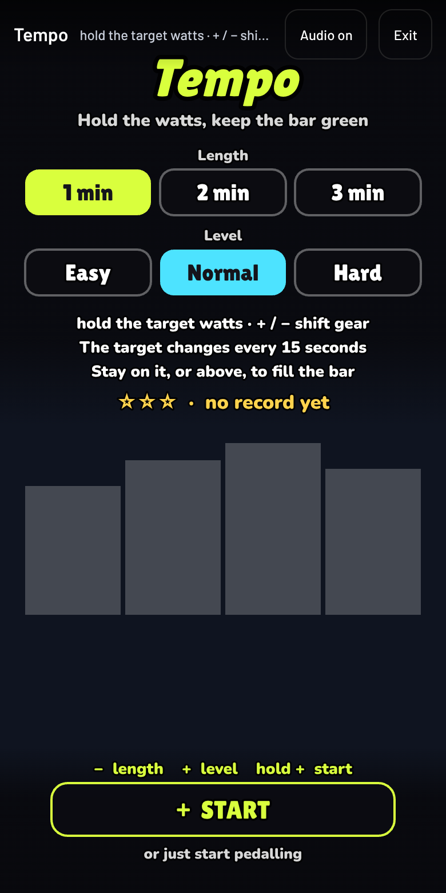
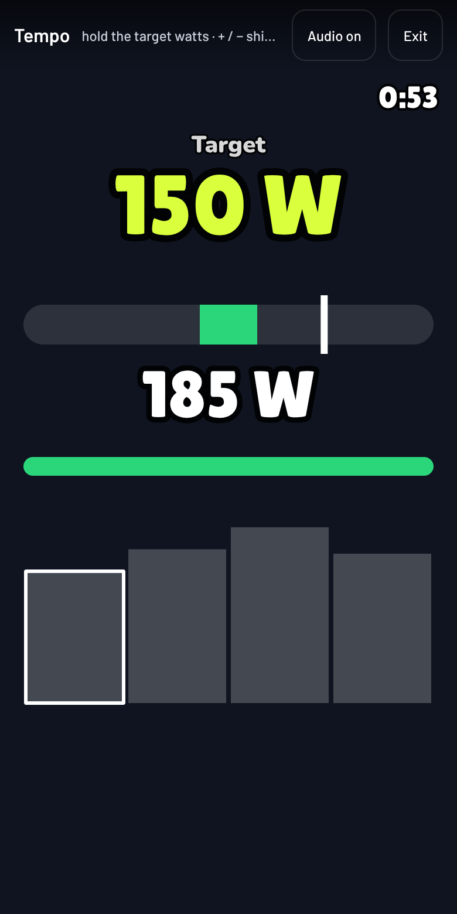
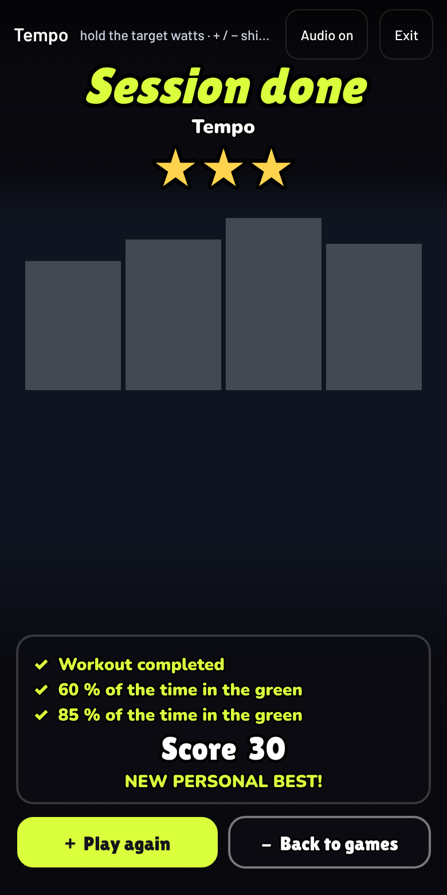

# Create a game

From a fresh clone to a game on your screen in about 15 minutes, then to a pull request.
You need Node 22 and git. No build step: the app is plain ES modules.

A game is **one folder, one registry entry, its strings**. This guide copies the template game, "Tempo", and turns it into yours.

## 1. Clone and run (3 minutes)

```sh
git clone https://github.com/C1aud1o/Spindro.git && cd Spindro
git checkout -b game/mygame beta        # work on a branch off beta
npm ci
npm run dev                             # static server, no build: http://127.0.0.1:5173
```

Open the link the command prints for the template game:

**http://127.0.0.1:5173/index.html?game=tempo&demo=1**

`?game=<id>` opens a game straight away; `demo=1` replaces the trainer with a **simulated rider**. A small panel at the bottom
has sliders for power and cadence and − / + buttons; keys: `W`/`S` power, `R`/`F` cadence, `A`/`D` (or ← →) = − / +, `H` hides the panel.
Reload the page after every change: there is nothing to build.

| the menu (shared by all games) | playing | the results (shared by all games) |
|---|---|---|
|  |  |  |

Play it once. The goal of Tempo: hold the target watts. Everything you see besides the playing screen (menu, stars,
results, long-press to start, workout mode) is the shared kit: you do not write it.

## 2. Copy the template (2 minutes)

```sh
mkdir js/games/mygame
cp js/games/template/tempo.js js/games/mygame/index.js
```

In `js/games/mygame/index.js` change two things:

- `export class Tempo` → `export class MyGame`
- `const ID = 'tempo'` → `const ID = 'mygame'` (lowercase letters and digits only)

and replace the text keys `games.tempo.` with `games.mygame.` (search and replace in the file). Keep the imports as they are:
the folder is at the same depth as `template/`.

For a three.js game start from `js/games/template/skeleton3d.js` instead (shared stage, sky, lights and cyclist).

## 3. Register it (1 minute)

In [`js/games/registry.js`](../../js/games/registry.js) add one line to `GAMES`, before the template entries:

```js
defineGame({ id: 'mygame', icon: 'G1', dev: true, load: () => import('./mygame/index.js').then((m) => m.MyGame) }),
```

`dev: true` keeps it out of the list for normal users while you work (turn on developer mode: seven taps on the version number
in Settings; the `?game=mygame` link works regardless). Remove it when the game is ready.

## 4. Add your strings (3 minutes)

Every word the rider sees goes through `t('games.mygame.key')` and exists in the five files `locales/{en,it,fr,es,de}.json`.
Copy the block of `games.tempo.*` keys in each file, rename them to `games.mygame.*` and write your texts. The three you must
always have: `name` (title), `desc` (what you do and what the workout is, 1–2 sentences, shown on the card) and `help` (the
controls, **one line**). Then:

```sh
node tests/i18n-check.mjs      # fails if a key is missing in a language or a {placeholder} differs
```

If you do not write a language, put the English text there and say so in the pull request; a native speaker can fix it later.

## 5. Make it yours (the real work)

Open `index.html?game=mygame&demo=1`. Edit `js/games/mygame/index.js`:

- `update(dt)` runs every frame: read the rider with `this.hooks.stats()` → `{ power, cadence, gear, heartRate }` and the
  FTP with `this.hooks.ftp()`. **All targets are a fraction of FTP** (`0.9 * ftp`), never fixed watts.
- `draw(dt)` draws on the canvas with the shared HUD helpers (`txt`, `panel`) from `kit/hud.js`.
- `input(dir)` receives **exactly +1 or −1** (Zwift Click or keys `+`/`-`/`A`/`D`): give it one meaningful action.
  Every game must be playable with + / − and the pedals alone.
- When the run ends call `finish()` as Tempo does: stars 1–3, a score, a personal best through `hooks.progress`.
- Workout mode: if `this.hooks.workout()` returns a plan, the workout decides the targets and the length. Tempo shows how
  (`WorkoutClock`, `wkTarget`, `workoutStars`).

The whole interface is in [API.md](API.md); the rules for what makes a good game are in [DESIGN-RULES.md](DESIGN-RULES.md).

## 6. Check it with the bot (2 minutes)

```sh
npm run game:check -- mygame
```

It plays your game at 0.6 / 0.8 / 1.0 / 1.2 × FTP with the demo rider and prints:

```
| × FTP | stars | expected | first event (s) | longest gap (s) | events/min | game s | ms/frame |
|---|---|---|---|---|---|---|---|
| 0.6 | 1 | 1 | 0.0 | 4.0 | 17.0 | 60 | 0 |
| 1 | 3 | 2-3 | 0.0 | 4.0 | 17.0 | 60 | 0 |
✓ all rules respected
```

When a rule is broken it says which and how to fix it (for example *"longest gap without an event 9.2 s (rule: never more
than 5 s)"*). Fix it until it prints `✓`. `npm run game:check -- mygame --seconds 60 --levels 1` is a quick look at the first minute.
Your game must keep a list of events and answer `eventStats()` (Tempo: ten lines) so the bot can measure it.

## 7. Add a test (2 minutes)

Copy the Tempo block of [`tests/games-registry.spec.mjs`](../../tests/games-registry.spec.mjs) (open with `?game=mygame&demo=1`,
set the power with `window.__demo.set({ power })`, start with `__game.menu.start()`, run `__game.update(1/30)` until
`__game.state === 'results'`, check the stars) into `tests/mygame.spec.mjs`. Tests seed `localStorage.setItem('analytics','0')`
and pass only `+1` / `-1` to `game.input()`.

## 8. Ship checklist, then the pull request

```sh
npm ci
npm test                                   # Playwright, uses the simulated trainer
node tests/i18n-check.mjs
node tests/trainers/run.mjs
node tests/controllers/zwift-controllers.test.cjs
```

1. Remove `dev: true` from your registry entry, and add every file the game imports to `ASSETS` in `sw.js` (the test
   `registry: every file a shipped game imports…` lists the missing ones). Bump the cache name (`spindro-v86` → `v87`).
2. Assets (images, sounds, models) need a clear licence (CC0 / MIT / OFL, or made for the project) and a line in `README.md`
   and `docs/legal/licenses.*.md`. No new third-party dependencies.
3. Do not recreate an existing commercial game: a genre or a mechanic is fine, a clone is not.
4. Commit in English, imperative, with the sign-off (`git commit -s`, see [CONTRIBUTING.md](../../CONTRIBUTING.md)); push your
   branch and open a pull request **against `beta`**. The template asks for the checklist in
   [DESIGN-RULES.md](DESIGN-RULES.md#review-checklist-for-a-new-game) and for the `game:check` table.

Never claim a device or a trainer is "verified" unless you tested it on real hardware.

## When something does not work

| symptom | cause |
|---|---|
| blank page or a stuck "loading" | open the browser console: a typo in an import path, or a missing key in a locale file |
| your game is not in the list | it has `dev: true` (use the `?game=` link or developer mode), or the registry line has a syntax error |
| the card shows `games.mygame.name` | the key is missing in `locales/<current language>.json` |
| nothing responds to + / − | `input()` must handle the current `state` (menu → `this.menu.input(dir)`, results → `this.results.input(dir)`) |
| the game keeps running after Exit | `stop()` must undo what `start()` did: loop, `window` listeners, audio |
| `game:check`: *never reached the menu* | `state` must become `'menu'` at the end of `start()` |
